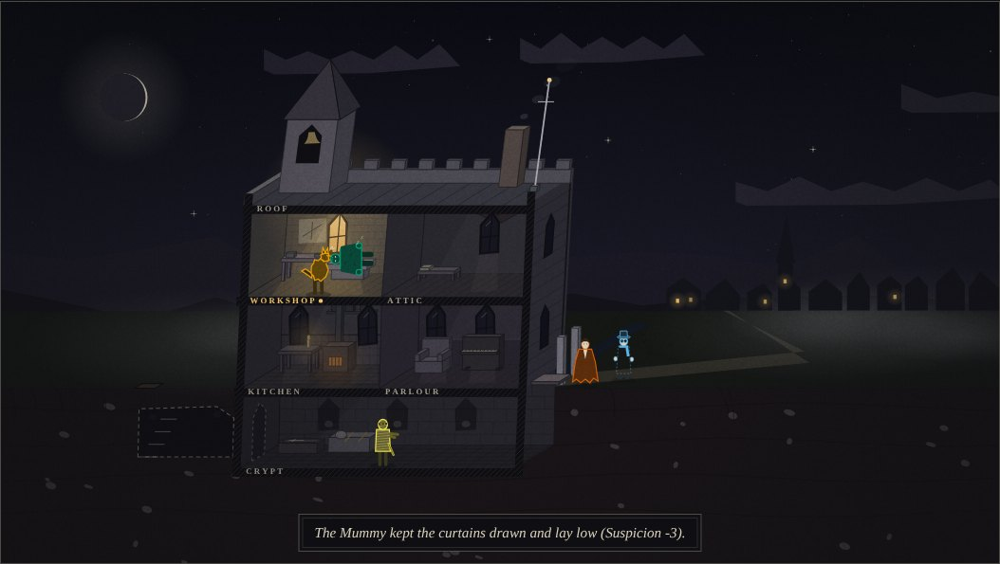

# Monster Manor

A life-sim where the household is a troupe of classic public-domain monsters
and the antagonist is the village's **Suspicion**. Keep everyone fed, rested
and inconspicuous for seven nights (or fourteen, or twenty-eight) and you win.
Let Suspicion hit 100 and the mob is at the door.

The simulation is pure, deterministic TypeScript that emits a plain event log.
Two clients read that log: a text-mode CLI and a browser client with an
isometric view, a dusk planning screen and a HUD.

```text
Night 3 — The Count worked a quiet shift as night watchman (Suspicion -8, +6 coin). The Wolf Man ate (hunger +50). The Golem bought a plant and no one came, but the walk did him good (social +10). Suspicion 43 -> 42 (incl. rumour +4).
  · The Wolf Man's fun has become critical (16).
  · The Wolf Man is fuming about fun (anger +10).
  · Lamplight showed in the kitchen (Suspicion +1).
```

## Quick start

Requires Node 22.18+ and pnpm.

```sh
pnpm install
pnpm check                      # lint + typecheck + all feature tests (what CI runs)
pnpm play --seed 42             # 7 nights in the terminal with the default plan
pnpm dev                        # the browser client at http://localhost:5173/?seed=42
```

### The CLI

```sh
pnpm play --seed 7 --plan plans/example.json
pnpm play --seed 42 --verbose                      # one plain-English line per event
pnpm play --seed 42 --json                         # the raw Event[] log
pnpm play --household count,mummy,invisible        # choose who lives here
pnpm play --setting valley                         # the Welsh folklore village and household
pnpm play --run long --difficulty harsh            # 28 nights, a village that forgets slowly
pnpm play --sandbox                                # the mob never ends the run
pnpm play --until 3 --save s.json; pnpm play --load s.json
pnpm play --lang cy                                # Welsh, falling back to English line by line
pnpm play --telemetry runs.ndjson; pnpm telemetry runs.ndjson   # opt-in run statistics
pnpm play --help
```

The CLI exits 0 on a win and 1 on a loss. The same seed, options and plan
always produce the same log; CI diffs two runs of seed 42 to prove it.

### The browser client


`pnpm dev` serves `index.html`, which drives the same sim. URL parameters
mirror the CLI: `seed`, `household`, `setting`, `difficulty`, `nights`, `lang`,
`sandbox=1`, `stories=off`, plus `keyart=1` for the poster composition.

The stage is a leaning cutaway of the manor (cellar, two floors and the roof)
drawn procedurally from state and events: each resident has their own
silhouette and pose, sleepers lie on their beds, lit windows glow, and the
village, the hunter and the mob watch from the lane. Hover a resident for
what they are doing. Around it sit the HUD, the dusk plan with live risk
notes and tonight's story, the build catalogue, the night diary and a
field-guide bestiary that fills in as you meet each monster.

Keys: `R` runs the night, `space` skips the animation, `P` focuses the plan;
all three are remappable under *Settings*, along with text size, film grain
and vignette, and animation (off by default when the system asks for reduced
motion). `pnpm build` writes a static site to `dist/`.

The look is specified in [docs/art-direction.md](docs/art-direction.md), and
the design system that carries it out (tokens, themes, the component kit,
icons, the style guide at `/styleguide.html`, design lint and visual
regression tests) in [docs/design-system.md](docs/design-system.md).

```sh
pnpm tokens    # regenerate src/web/design/tokens.css from tokens.ts
pnpm shots     # rebuild and recapture the reference images in docs/art/
pnpm test -u   # accept a deliberate visual change (review the snapshot diff)
```



### Plan files

A plan is the dusk schedule. Each night names an action per resident, an
optional `day` slot (only residents who can act in daylight use it), an
optional `build` shopping list and optional story `choices`. If the plan is
shorter than the run, its last night repeats.

```json
{
  "nights": [
    { "night": { "count": "feed", "wolfman": "coverJob", "golem": "sleep" } },
    { "night": { "count": "socialise", "wolfman": "sleep", "golem": "repair" },
      "day":   { "wolfman": "coverJob" },
      "build": ["decoyCoffins"],
      "choices": { "lostTraveller": "takeIn" } }
  ]
}
```

A bare array of assignment objects is accepted as shorthand. Actions are
`feed`, `sleep`, `socialise`, `coverJob`, `repair`, `lieLow`, `gameNight`. A
resident left out of a night idles; a name that does not live here is reported
and ignored.

## The model

Everything in `src/sim` is plain data plus pure functions: no DOM, no
`Date.now`, and all randomness comes from a seeded RNG stored in the game
state. A save is just the seed, the options and the plan history, replayed.

### Needs

Eight needs per resident, each clamped to 0–100: `hunger`, `energy`, `social`,
`fun`, `hygiene`, `comfort`, `bladder`, `anger`. For every need except anger,
100 means satisfied. Anger is inverted: 0 is calm, 100 is furious. At dawn each
resident's `decay` table is subtracted; a need crossing below 20 emits a
`needCritical` event; then anger rises by 10 if any need they care about is
below 20 and falls by 5 otherwise.

### The household

Residents are chosen with `household` (default: the Count, the Wolf Man and the
Golem). Each archetype's rules are *quirks*: hook objects in a registry
(`src/sim/quirks.ts` for the launch trio, Mummy and Invisible Man;
`src/sim/archetypes/` for the rest).

| Resident | Inversion |
| --- | --- |
| **The Count** | Hunger only fills from `feed` at night. Energy drains by day. Hygiene never moves (no reflection). Charm works one villager up the relationship tree, +Suspicion. A pale villager each time he feeds, unless an ally volunteers. |
| **The Wolf Man** | Every 7th night is a full moon: hygiene and comfort crash, fun maxes, he blacks out, the kitchen is wrecked, Suspicion +15 (+10 on a shift). The only launch resident who can act by day. |
| **The Golem** | Social capped at 20 (villagers flee; he does not mind). Energy only through the lightning rod. Breaks furniture, which costs the whole house comfort. |
| **The Mummy** | Energy and bladder pinned at 100. Comfort unravels nightly; only a sarcophagus rewraps it. Every action costs two nights. Hoards artefacts that curse anyone else who moves them. |
| **The Invisible Man** | Social only fills when he has wrapped up to go out. Lying low means pranks. Food goes missing. Whatever Suspicion he raises is halved. |
| **The Lake Creature** | Hygiene is wetness and drains fast; the tub soaks it back and floods the hall half the time. Feeds from the moat. |
| **The Phantom** | Fun only from music: lying low plays the house organ, and the music carries. Company counts for half. At 60 anger the chandelier comes down. |
| **The Bride** | Lightning-powered. Refuses any action the Golem is doing and lies low instead. Lying low ends in a shriek. |
| **The Hunchback** | Villagers are not company, gargoyles are. The roof is sanctuary. The bells almost never fail him but leave him deaf. Acts by day. |
| **Y Gwyllgi, Cŵn Annwn, Gwrach y Rhibyn** | The valley set (`--setting valley`): a death omen on the road, hounds that ride every third night, a hag who wails at frightened windows. |

Turning a villager (see below) adds a fledgling resident; a resident who
reaches 90 anger moves out, and the mob can take one.

### The house

Rooms have windows, a light that comes on when someone acts there at night,
and sometimes a secret passage. **Exposure** (windows × 10, +15 lit, +5 per
broken piece) decides what Van Helsing snoops and where the mob goes; lit
windows add Suspicion at dawn. The house also holds furniture (beds matter: a
broken one halves sleep), the lightning rod, `householdAnger` (the residents'
mean), `coin` and four defences.

**Household anger** below 25 allows a game night; at 60 fights break out and
the lane hears them; at 80 someone may ignore the plan and go out; anyone at
90 moves out, and an empty manor is a loss.

**Build mode**: cover-job shifts pay 6 coin; the plan's `build` list buys from
a 15-item catalogue at dusk (beds, furniture, the lightning rod, drawbridge,
fog machine, decoy coffins, organ).

### The village

Ten named townies with jobs, suspicion weight, day/night routines and fence
neighbours. Each has private **awareness**: the Count's victims gain it, it
spreads along the fence while the village is gossiping, the outspoken add
Suspicion, quiet nights let it fade. Every townie sits somewhere on
**friend → confidant → thrall → turned**: anyone can befriend by socialising
(cap confidant); only the Count's charm goes further. Confidants are allies
(safe feeding, safer shifts, Suspicion −10 once), thralls talk rumours down
nightly, turning adds a resident and a +20 spike.

**Suspicion** is 0–100 with thresholds:

| Suspicion | Effect |
| --- | --- |
| 40 | Gossip: cover jobs 10 points riskier; awareness spreads along fences. |
| 70 | Van Helsing (the dyn hysbys in the valley) arrives. Each dawn he snoops the most exposed room: +3 unless someone lay low or the room has a passage; a resident who bumps into him distracts him; befriend him and he stops; he leaves below 50; he can be turned. |
| 90 | The mob gathers. By day it may march on the most exposed room. A drawbridge keeps it out, a fog machine loses it half the time, decoy coffins send it home once with −10, the organ halves its nerve, a passage spares the residents. |
| 100 | The mob is at the door: it takes the resident whose lit room it watched (Suspicion → 75), or burns the decoys (→ 80), or the manor falls. |

After a **noisy** night (anything raised Suspicion) dawn adds rumour (+4 at
standard difficulty); after a **quiet** one Suspicion drifts 3 toward a
baseline of 30. `gentle`/`standard`/`harsh` tune the drift, the rumour, the
starting value and the mob's nerve.

### Cover jobs

Each resident has one. Success: Suspicion −8 (more after promotions), +6 coin;
three in a row promote. Failure: +5 Suspicion and +15 workplace heat; at 50
the employer asks questions, at 100 the resident is sacked. A day shift after
a night shift is a clash.

### Story events

Twenty scripted collisions (a lost traveller, the census taker, a storm, a
full moon on the Count's shift…) fire at dusk, one at most per night, each once
per run, two nights apart unless urgent. The plan's `choices` pick the branch;
otherwise the first happens. On in the CLI and the browser, off in the bare sim
(`stories: true` to enable) so tests stay predictable.

### The night loop

`runNight(state, plan)` runs four phases, each exported separately for tests:

1. **dusk**: advance the night, assign actions, buy from the build list, fire a
   story, run `onDusk` quirks (the full moon rises here), maybe a rogue night.
2. **night**: resolve each resident's action in household order; quirks may
   cancel or replace it (`beforeAction`) and rewrite the log line
   (`afterAction`); then `onNight` quirks and maybe a fight.
3. **dawn**: decay, anger, move-outs, village gossip, lights seen, the hunter,
   rumour or quiet drift, one `Suspicion a -> b` event, threshold crossings,
   and at 100 the mob at the door.
4. **day**: everyone sleeps unless they can act by day (or drain, like the
   Count); a gathered mob may attack; surviving the final night wins. Both
   endings close with a `summary` event.

Every phase appends `Event` objects to `state.log`:
`{ night, phase, kind, monsterId?, text, data? }`. `text` is what the clients
print, `data` carries the numbers.

### Localisation

Every sentence goes through `t(key, params)` and `src/sim/strings/en.ts`.
`src/sim/strings/cy.ts` is a partial Welsh table (drafted without a native
reviewer; corrections welcome); missing keys fall back to English. `pnpm i18n`
lists what is left. The locale changes words only: a test replays a seed in
both and compares the log shape.

## Layout

```text
src/sim/            pure simulation
  types.ts          Monster, Needs, Action, Event, House, Village, Townie, GameState, Plan
  rng.ts            seeded RNG (mulberry32)
  needs.ts          defaults and clamping
  context.ts        emit / adjustNeed / addSuspicion helpers shared by hooks
  quirks.ts         the quirk registry and the launch trio's, Mummy's and Invisible Man's rules
  archetypes/       Lake Creature, Phantom, Bride, Hunchback, the Welsh set
  monsters.ts       factories, PLAYABLE, DEFAULT_HOUSEHOLD, VALLEY_HOUSEHOLD
  fledgling.ts      a turned villager
  house.ts          rooms, exposure, lights, furniture, defences
  village.ts        thresholds, moods, Suspicion constants
  townies.ts        the rosters, awareness, the relationship tree, the hunter
  anger.ts          household anger: game night, fights, rogue nights, move-outs
  actions.ts        the seven actions, cover-job careers
  build.ts          the catalogue and purchases
  mob.ts            mob targeting, defences, the mob at the door
  stories.ts        twenty story events
  difficulty.ts     presets, run lengths, sandbox
  plan.ts           default plans and plan-file parsing
  save.ts           save/load by replay
  i18n.ts, strings/ the string tables
  loop.ts           dusk / night / dawn / day, runNight, runGame, play
src/cli/            text-mode runner, telemetry, i18n report
src/web/            browser client
  viewmodel.ts      pure state → view mapping (sprites, HUD, risk hints)
  render.ts         the stage: composes the art into one frame, returns hit boxes
  art/              palette, stage projection, figures, furniture, scenery,
                    post effects and bestiary copy
  design/           tokens.ts (colours, themes, scales, motion) → tokens.css
  kit/              h() view layer, components, icons
  views.ts          header, HUD, plan, diary, bestiary as pure views
  styleguide.ts     the living style guide (styleguide.html)
  ui.ts, styles.css the shell and the styles; main.ts wires it together
scripts/            shots.ts: capture the reference images
features/           one Gherkin file per feature (33)
tests/              one Vitest spec per feature; steps.ts maps steps to sim calls
plans/              example plan file
docs/               backlog, playtest notes, IP audit, art direction and reference images
.github/            CI: lint, typecheck, test, replayable smoke play
```

## How to add a monster

1. Add its id to `Archetype` in `src/sim/types.ts`, and its quirk ids to
   `QuirkId`.
2. Create `src/sim/archetypes/<name>.ts`. Call `registerQuirk()` for each
   quirk: an object with any of `onDusk`, `beforeAction`, `afterAction`,
   `onNight`, `onDawn`, `onDay`, `filterNeedChange` and `ignoredNeeds`.
   Prefer `filterNeedChange` for "this need only moves when…" rules and
   `beforeAction` for "tonight it does something else instead". Export a
   `createX()` factory with needs, a `decay` table, `bedroom` and `bed`, the
   quirk list, a cover job (`job(title, relief, failChance)`) and
   `daylightActive`.
3. Register it in `src/sim/monsters.ts` (`createArchetype`, `PLAYABLE`) and
   give it a bed in `createHouse()` if it needs one the house lacks.
4. Give it an accent in `ACCENTS` (`src/web/viewmodel.ts`) that clears 3:1
   contrast on ink, a silhouette in `FIGURES` (`src/web/art/figures.ts`), a
   bed in `FURNITURE` if it brings one, field-guide copy in
   `src/web/art/bestiary.ts`, and a row in `docs/ip-audit.md`.
   `tests/art.spec.ts` fails until all of these exist.
5. Write `features/<name>.feature`, then `tests/<name>.spec.ts` using the
   helpers in `tests/steps.ts` (`seedWhere` pins any random roll). Use a small
   `household` in tests so other residents' rolls do not shift yours.
6. `pnpm check`, then `pnpm play --household count,<name>` and read the prose.

All creatures and names are drawn from folklore and public-domain literature;
`docs/ip-audit.md` is the checklist and `tests/ip.spec.ts` enforces it.
