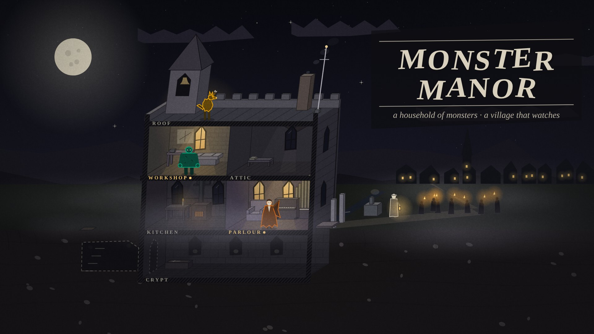
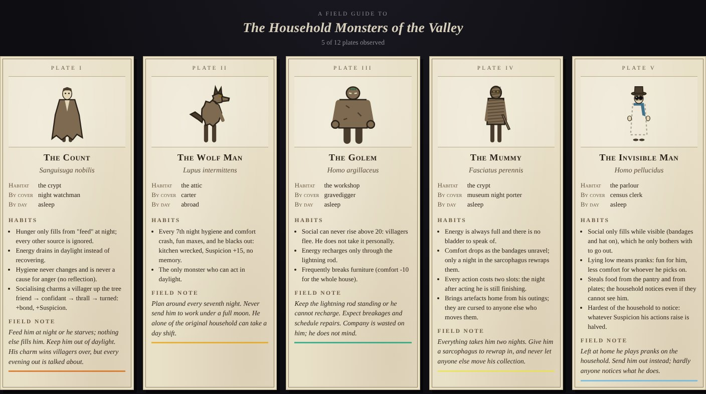
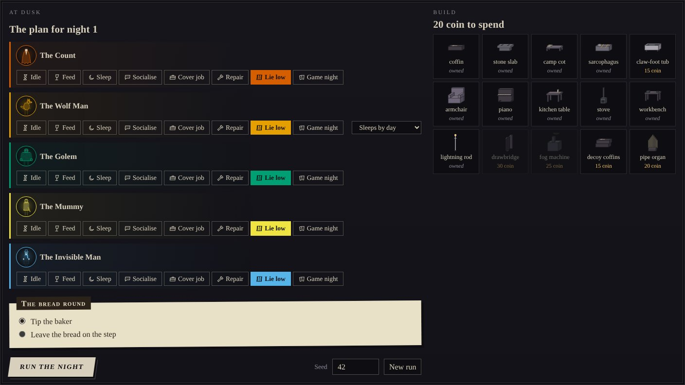

# Art direction (MM-31)

The style sheet for Monster Manor. It covers the browser client today and is
the brief for any painted art that replaces the procedural drawings later.

## The idea

**An expressionist theatre set, recorded in a 1930s field guide.** The manor
is a stage with the front wall taken away. Its walls lean, its windows are
cut crooked, and its light is painted on in hard-edged shafts rather than
falling off softly. Everything outside the residents is monochrome. The
interface around the stage reads like old print: small capitals, rules,
paper plates.

Two rules carry the whole look:

1. **Colour belongs to the residents.** Each archetype owns one accent. It
   appears on their silhouette's rim, their portrait, their plan row, their
   lines in the night diary and the rule under their bestiary plate. Nothing
   else in the world uses it.
2. **The only warm light is lamplight.** A lit window is exactly what the
   village sees and what raises Suspicion, so it is the one warm thing on a
   cold stage. Moonlight is bone-white; daylight is overcast paper.

## Palette

Defined once in `src/web/design/tokens.ts`: the primitives below feed both
the canvas (`src/web/art/palette.ts`) and the interface, through colour roles
per theme. See [design-system.md](design-system.md) for the roles, the
Paper and High-contrast themes, and how to change a colour.

| Token | Hex | Role |
| --- | --- | --- |
| Ink | `#0e0e12` | Night sky, cut faces, outlines, page background |
| Soot | `#17171d` | Panels |
| Charcoal | `#222129` | Raised panels, settings popover |
| Slate | `#34333d` | Stone, shadowed walls |
| Ash | `#5b5966` | Secondary detail |
| Pewter | `#8c8896` | Secondary text, labels |
| Bone | `#d8d0bc` | Primary text, moonlight, faces |
| Paper | `#ece5d3` | Daylight sky, emphasis |
| Plate paper | `#e9e0c8` | Bestiary plates, story cards, tooltips |
| Sepia | `#2b2219` | Ink on plates |
| Lamp | `#f2c46b` | Lamplight only: lit windows, candles, the lit-room marker |
| Warn | `#e3a33a` | Interface: Suspicion past 70, risk notes |
| Alarm | `#d0453b` | Interface: Suspicion past 90, critical needs, breakages |

### Resident accents

Drawn from the Okabe–Ito and Tol colour-vision-safe sets, then adjusted so
every accent clears 3:1 contrast against ink (`tests/art.spec.ts` checks
this). The turned fledgling shares the Count's accent.

| Resident | Accent |
| --- | --- |
| The Count | `#D55E00` vermilion |
| The Wolf Man | `#E69F00` orange |
| The Golem | `#009E73` bluish green |
| The Mummy | `#F0E442` yellow |
| The Invisible Man | `#56B4E9` sky blue |
| The Lake Creature | `#0072B2` blue |
| The Phantom | `#CC79A7` reddish purple |
| The Bride | `#999999` grey |
| The Hunchback | `#AA7744` bell bronze |
| Y Gwyllgi | `#9988DD` lavender (the glow of its eyes) |
| Cŵn Annwn | `#44AA99` teal |
| Gwrach y Rhibyn | `#DDCC77` sand |

Accent colour is never the only signal: every resident also has a name, a
distinct silhouette and a position on stage.

## Shape language

- **Lean.** The house shears right as it rises (`LEAN` in
  `src/web/art/stage.ts`), so verticals bend into a slight curve.
- **Cut, not drawn.** Windows are irregular lancets with uneven sills.
  Cloak hems and fur are jagged polygons. Clouds are angular bands.
- **Painted light.** Moonlight through a window is a pale quadrilateral on
  the floor. A lit room gets a hard lamplight cone. Every back wall carries a
  painted diagonal shadow.
- **Section drawing.** Wherever the cutaway slices through floors and walls,
  the cut face is solid ink with a fine hatch (architectural poche). Room
  names are lettered on those cuts, as on an architect's section.
- **Silhouette first.** Each resident must read as a black shape at 40 px
  before any detail is added. Their silhouettes follow the "avoid" column of
  `docs/ip-audit.md`; that document wins any disagreement with this one.

## The stage

An oblique cutaway, depth receding up and to the right, so every floor and
everyone on it stays visible. From the bottom up:

| Level | Rooms |
| --- | --- |
| Cellar | The crypt (and the secret tunnel, when it has one) |
| Ground | Kitchen, parlour |
| Upper | Workshop, attic |
| Roof | Bell turret, chimney, lightning rod, parapet |

Outside: the moat and gate (drawbridge raised when built), the lane to the
village, the hunter with his lantern, the mob's torches, fog, and the village
on the far hill whose lit windows rise with Suspicion.

Residents act at the front of their room like actors at the footlights.
Sleepers lie on their own bed. Anyone out for the night stands on the lane.

## Light by phase

| Phase | Sky | Interiors |
| --- | --- | --- |
| Night | Ink with seeded stars, the moon to its phase | Unlit rooms sink to near black; lit rooms glow lamp-warm |
| Dusk | Bruised violet-grey | Half lit |
| Day | Overcast paper | Fully lit; residents asleep |

The client eases between phases rather than cutting.

## Post-processing

- **Grain and vignette** are one player setting (on by default). The grain
  holds still when animation is off.
- **Title cards** use expressionist lettering: each capital leans and sits a
  little off the line, cut from card, with a hard ink drop shadow.

## Motion

Figures breathe, walk with a swing, and gesture when they act. Candles and
lanterns flicker, smoke and fog drift, the bell sways, and lightning finds
the rod when someone in the house runs on it. With animation off (the
default when the system asks for reduced motion) every one of these holds
still; `tests/art.spec.ts` checks that.

## Typography

One serif stack throughout: Iowan Old Style, Palatino, Book Antiqua, Georgia.
No web fonts, so the client works offline and in a desktop wrapper.

- Eyebrows and labels: uppercase, 0.2em tracking, pewter.
- Headings: semibold, bone. Display: italic, skewed.
- Numbers: tabular lining figures.
- Plates: small capitals for names, italic for binomials and field notes.

## The bestiary

A field guide to *The Household Monsters of the Valley*. Each plate has a
Roman numeral, a sepia engraving of the resident (the same geometry as the
stage, in plate style), a mock-Latin binomial, habitat and cover job, habits
taken from the sim's own quirk descriptions, and a field note that doubles
as the tutorial. Plates unlock the first time a resident lives in your
manor and stay unlocked between runs. Locked plates show a dark silhouette.

## Interface

- Panels are soot with a hairline bone rule and an inset double border.
- The primary button is bone on ink, skewed, with a hard offset shadow.
- Action choices are radio tiles; the chosen tile fills with the
  resident's accent.
- Story events arrive on a paper card, slightly askew.
- Build items are drawn with the same art as the stage.

## Producing reference images

`?keyart=1` renders the poster composition at 1920 × 1080. `pnpm shots`
rebuilds the client and recaptures everything in `docs/art/`; run it after
visual changes so this page stays true. Visual changes are also caught by
fingerprint tests (see [design-system.md](design-system.md)).

## When painted art arrives

Replace drawers one at a time behind the same functions: `drawFigure` for
residents, the `FURNITURE` and `FIXTURES` maps for objects, and the scenery
functions for the backdrop. Keep the palette, the accent rule and the
lamplight rule, and run every new silhouette past `docs/ip-audit.md`.
