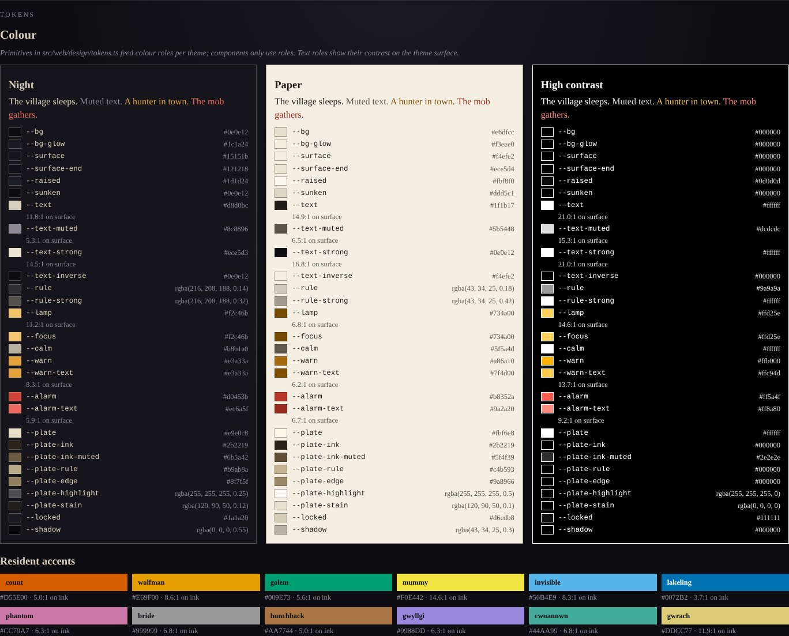

# Design system (M4)

How the interface is put together, and how to change it without it drifting.
The *look* (palette, shape language, lighting, typography) is specified in
[art-direction.md](art-direction.md); this document is the machinery that
carries it out.

The fastest way to see all of it is the style guide: `pnpm dev`, then open
`/styleguide.html` (or follow *Style guide* in the game's header).



## The pieces

| Piece | Where | What it is |
| --- | --- | --- |
| Tokens | `src/web/design/tokens.ts` | Every colour, size and timing, as typed data |
| Generated CSS | `src/web/design/tokens.css` | Custom properties per theme, written by `pnpm tokens` |
| Stylesheet | `src/web/styles.css` | Component styles; uses only tokens |
| Canvas palette | `src/web/art/palette.ts` | Primitives for the stage art, read from the tokens |
| View layer | `src/web/kit/h.ts` | `h()`, `render()`, `mount()`, inspection helpers |
| Components | `src/web/kit/components.ts` | Meter, gauge, chip, tiles, toggle, select, button, story card, catalogue item, portrait, plate |
| Icons | `src/web/kit/icons.ts` | 24-unit line icons |
| Views | `src/web/views.ts` | Header, HUD, plan, diary, bestiary: `state → VNode` |
| Shell | `src/web/ui.ts`, `src/web/main.ts` | Layout, persistence, mounting, the game loop |
| Style guide | `styleguide.html`, `src/web/styleguide.ts` | Everything above, rendered |
| Design lint | `tests/design.spec.ts` | Tokens current, no raw values, scales, focus, contrast |
| Kit tests | `tests/kit.spec.ts` | Accessible names, meter values, draft editing, rendering |
| Visual regression | `tests/visual.spec.ts` | Fingerprints of every drawing |
| Reference images | `scripts/shots.ts` → `docs/art/` | `pnpm shots` |

## Tokens

Tokens have two layers.

- **Primitives** are the raw palette, named for what they look like (`ink`,
  `bone`, `lamp`). The canvas art may use them directly.
- **Roles** say what a colour is *for* (`surface`, `text-muted`,
  `warn-text`, `plate-ink`). Each theme assigns every role. Components only
  ever use roles.

Where one colour cannot serve both as a fill and as text, there are two
roles: `warn` / `warn-text`, `alarm` / `alarm-text`.

Two custom properties are set inline per resident rather than by a theme:
`--accent` (the resident's colour) and `--on-accent` (ink or white,
whichever reads better on that accent; see `onAccent()`).

`pnpm tokens` regenerates `tokens.css`. A test fails if you forget.

### Scales

| Scale | Tokens | Notes |
| --- | --- | --- |
| Type | `--text-2xs` … `--text-display` | Nothing smaller than `2xs` (0.72rem); the root follows the text-size setting |
| Space | `--space-1` … `--space-40`, `--gutter` | Named by pixel size: `--space-10` is 10 px |
| Motion | `--dur-fast`, `--dur-medium`, `--dur-slow`, `--ease-standard` | Zero under `.reduce-motion` |
| Breakpoints | `BREAKPOINTS` in TS | Media queries can't read variables; a test keeps them equal |

The client reads its own timings (title-card holds, diary reveal, light
easing) through `motion(key, animate)`, which returns the token or its
reduced-motion equivalent.

## Themes

| Theme | For | Notes |
| --- | --- | --- |
| Night | Default | Ink and bone |
| Paper | Daytime reading | Light field-guide interface; the stage stays a night scene |
| High contrast | Low vision | Black and white, no translucency; default when the system prefers more contrast |

The theme is `data-theme` on `<html>`, chosen under *Settings → Theme*.

Every theme must pass these, checked in `tests/design.spec.ts`:

- 4.5:1 for body, muted, strong, warning, alarm and lamp text on every
  surface;
- 4.5:1 for button text on its fill and for plate ink on plates;
- 3:1 for focus rings and meter fills;
- 4.5:1 for each resident's label on its accent.

## The design lint

`tests/design.spec.ts` reads `styles.css` and fails on:

- any hex, `rgb()`, `hsl()` or named colour (use a role, or
  `color-mix()` on roles for tints);
- any `var(--…)` that no token or rule defines;
- a `font-size` that is not a `--text-*` token;
- `padding`, `margin` or `gap` built from anything but `--space-*`,
  `--gutter`, `0` or `auto`;
- a `transition` with a literal duration;
- a media-query width that is not a breakpoint token;
- a missing global `:focus-visible` outline, or a visually hidden input
  whose label has no focus style;
- bare millisecond timings in `main.ts`.

## The kit

Components are functions that return **VNodes**: plain objects of `tag`,
`props` and `children`. The browser turns them into DOM with `mount()`;
tests inspect them directly in Node.

```ts
import { h } from './kit/h.ts';
import { meter } from './kit/components.ts';
import { icon } from './kit/icons.ts';

const view = h('div', { class: 'needs' },
  meter({ label: 'hunger', value: 42, tone: 'warn', icon: icon('hunger', 12) }),
);
```

Props work like this:

- strings and numbers become attributes, `true` a bare attribute, and
  `false` or `undefined` are omitted;
- `style` takes an object, custom properties included;
- `onClick`, `onChange` and the like attach listeners;
- `checked`, `value`, `disabled`, `selected` and `hidden` are set as
  properties;
- `draw` on a `<canvas>` is called once the element exists.

`fragment(...)` returns several siblings without a wrapper. Use it when the
container lays out its direct children with grid or flex.

Every component carries its own ARIA. `tests/kit.spec.ts` checks that every
button, input, select, radio group and meter in every view has an
accessible name. Use `accessibleName()` and `interactive()` from `h.ts` in
new tests.

## Icons

24 × 24 line icons with stroke 1.7, square caps, mitred joins and a 6°
lean, drawn in `currentColor`. They are always `aria-hidden` and always sit
beside a text label; a test fails if one appears alone.

## Visual regression

`tests/visual.spec.ts` draws every figure (in every pose and style), every
furniture and catalogue drawing, every icon, five stage scenes and a title
card on the recording canvas. It compares a fingerprint of each with
`tests/__snapshots__/visual.spec.ts.snap`.

- An **unintended** change fails, naming the drawing.
- An **intended** change: run `pnpm test -u`, look at the style guide, and
  commit the snapshot diff together with `pnpm shots` output so reviewers
  see both the hash and the picture.

## How to…

### Add or change a colour

1. Edit the role in every theme in `THEMES` (or add a primitive first).
2. `pnpm tokens`.
3. Use `var(--your-role)` in `styles.css`.
4. `pnpm test`: the contrast scenario will tell you if any theme fails.

### Add a size or a timing

Add it to `TYPE`, `SPACE` or `MOTION`, run `pnpm tokens`, use the variable.
Never write the number in `styles.css`; the lint will catch it.

### Add an icon

Add path data to `ICONS` on the 24-unit grid. Check it in the style
guide's *Icons* section next to the others, then run `pnpm test -u`.

### Add a component

1. Write a function in `components.ts` that returns a VNode, takes its data
   and callbacks as props, and sets its own ARIA.
2. Style it in `styles.css` with tokens only.
3. Show it, in each of its states, in the style guide's *Components* section.
4. Use it from a view; extend `tests/kit.spec.ts` if it introduces a new
   kind of control.

### Add a theme

1. Add the name to `ThemeName` and `THEME_LABELS`, and fill every role in
   `THEMES`.
2. `pnpm tokens`.
3. Run `pnpm test`: the completeness and contrast scenarios cover it
   automatically.
4. Check it in the style guide, which shows every theme side by side.

### Refresh the reference images

`pnpm shots`. It uses `playwright-core`'s Chromium; set `CHROMIUM_PATH` to
use another binary.
